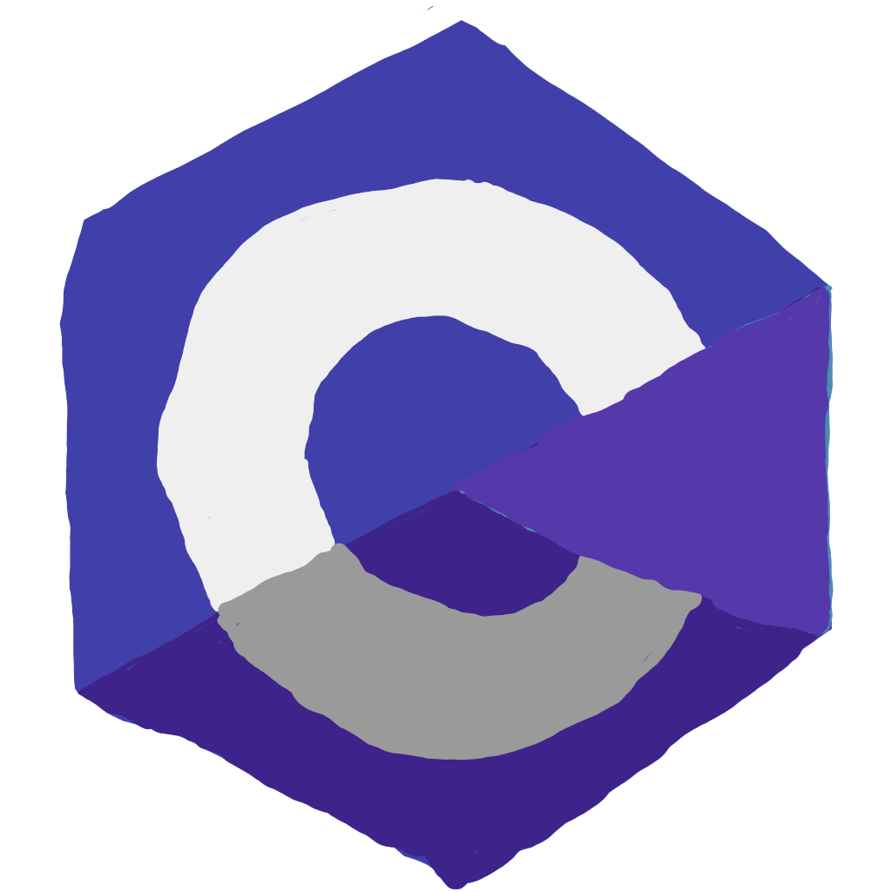
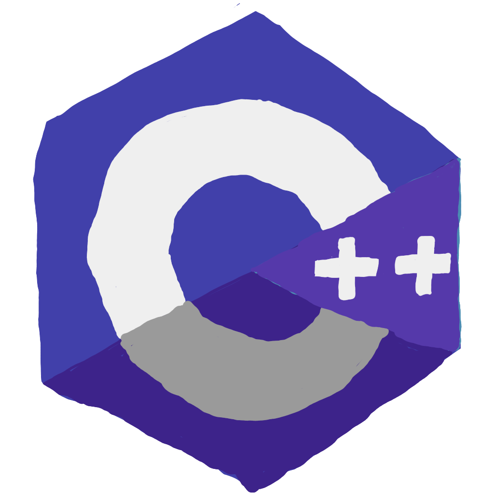
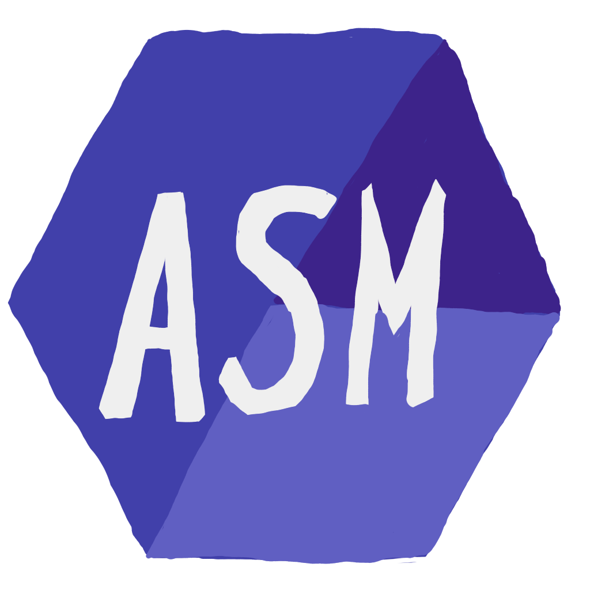

## 🔭✨
&emsp;<ins>**_Programador_**</ins> e <ins>**_Artista_**</ins> graduando _Tecnologia em Análise e Desenvolvimento de Sistemas_ pelo _Instituto Federal do Amazonas_. 

&emsp;Tenho interesse em programação de _baixo nível_, _compiladores_, _emuladores_ 🎮 e pedaços de hardware antigos e obsoletos 💾 mas ainda com grande potencial.  
> _**Linguagens que melhor domino!**_

  
  
  

<!--
**kprincipe/kprincipe** is a ✨ _special_ ✨ repository because its `README.md` (this file) appears on your GitHub profile.

Here are some ideas to get you started:

- 🔭 I’m currently working on ...
- 🌱 I’m currently learning ...
- 👯 I’m looking to collaborate on ...
- 🤔 I’m looking for help with ...
- 💬 Ask me about ...
- 📫 How to reach me: ...
- 😄 Pronouns: ...
- ⚡ Fun fact: ...
-->
